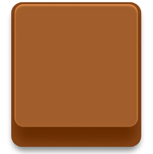
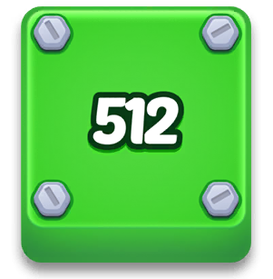
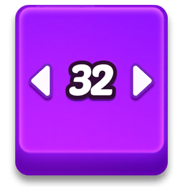

# 📘 TÀI LIỆU ĐẶC TẢ INGAME OBSTACLES & MECHANICS
## HƯỚNG DẪN ĐẶT HÀNG THIẾT KẾ UI & 2D GAME ASSETS
> **Dự án:** 2048 Block Order (*Blocked-In*)  
> **Phiên bản:** 1.0 (Production Ready)  
> **Đối tượng sử dụng:** Lead Game Designer, UI/UX Designer, 2D Game Artist, Technical Artist.

---

## 🎯 1. TỔNG QUAN HỆ THỐNG VẬT CẢN & CƠ CHẾ INGAME
Trò chơi là sự kết hợp giữa **Ghép số 2048 (Number Merge)** và **Giải đố xếp hình khối đa giác trượt (Polyomino Sliding Puzzle)**.  
Để tạo chiều sâu chiến thuật và phân cấp độ khó qua từng màn, hệ thống ingame được chia thành 4 nhóm thực thể chính:

```mermaid
flowchart TD
    subgraph INGAME["HỆ THỐNG INGAME (BOARD & PIECES)"]
        direction TB
        A["1. Static Obstacles<br>(Chướng ngại vật địa hình tĩnh)"] --> A1["Tường cản bàn cờ (Walls)"]
        A --> A2["Trụ đảo nổi (Inner Wall Pillars)"]
        A --> A3["Lòng hố bàn cờ (Cavity Cliff)"]

        B["2. Dynamic Obstacles<br>(Vật cản động trên bàn)"] --> B1["Khối Chặn Dud (Blocker)"]
        B --> B2["Khối Bắt Vít (Stationary / Pinned)"]
        B --> B3["Khối Băng Khóa Số (Ice / Frozen)"]

        C["3. Kinematic Constraints<br>(Giới hạn hướng di chuyển)"] --> C1["Trượt ngang duy nhất (Horizontal Only)"]
        C --> C2["Trượt dọc duy nhất (Vertical Only)"]
        C --> C3["Hợp nhất hướng sau Merge (Resolve Axis)"]

        D["4. Board Boosters & Target<br>(Hỗ trợ & Mục tiêu kết màn)"] --> D1["Booster Level Up (Hút cặp tức thì)"]
        D --> D2["Booster Time Freeze (Đóng băng đếm giờ)"]
        D --> D3["Bình Ma Thuật & Suối Nước (Magic Sand Jar)"]
    end
```

---

## 🎨 2. PHONG CÁCH NGHỆ THUẬT & QUY CHUẨN ĐỒ HỌA (ART STYLE & SPECS)

### 2.1. Ngôn ngữ thị giác (Visual Language)
* **Phong cách:** **Casual 3D Glossy / Chibi Toy** (khối gạch đồ chơi nhựa bóng bẩy, bo góc mềm mại, có độ dày 3D, ánh sáng bóng loáng phản chiếu bề mặt).
* **Độ dày khối (Lip / 3D Bevel):** Mỗi khối có độ dày thành đáy hướng xuống dưới $\approx 15\% - 20\%$ kích thước ô cờ (`cellSize`), tạo cảm giác viên gạch nổi hẳn lên khỏi mặt sàn.
* **Quy chuẩn Font chữ số:** Dòng font hoạt hình dập nổi, nét tròn đầy đặn (PoetsenOne / Baloo 2), bắt buộc có 3 lớp viền:
  * **Stroke 1 (Viền ngoài cùng):** Đậm màu, tương phản với màu khối.
  * **Stroke 2 (Viền giữa):** Sáng nhẹ tạo bóng nổi.
  * **Fill chính:** Màu trắng tinh khiết hoặc màu dập nổi theo palette số.

---

## 🔍 3. PHÂN TÍCH CHI TIẾT TỪNG INGAME OBSTACLE & MECHANIC

---

### 3.1. STATIC OBSTACLES: TƯỜNG CẢN & TRỤ ĐẢO ĐÁ NỔI (WALLS & INNER PILLARS)

#### A. Phân tích Gameplay & Vai trò
* **Bản chất:** Các ô lưới không thể chơi (`playable = false`).
* **Vai trò giải đố:** Tạo ra các vách ngăn, ngõ hẹp hình chữ Z, chữ U, hoặc các hốc giam giữ khối. Người chơi không thể kéo bất kỳ khối nào đi xuyên qua tường cản.
* **Đặc biệt (Trụ đảo nổi - Enclosed Wall Pillars):** Những ô tường nằm độc lập giữa lòng bàn cờ (như ở màn 5, 17, 20, 27, 33...) nhô lên như các trụ cột bàn cờ 3D.

#### B. Phân tầng đồ họa (Layering)
1. **Lòng hố bàn cờ (Board Cavity Floor):** Màu xanh thẫm hoàng gia (`#032690`), có lưới ô chìm (`Grid Lines`).
2. **Vách bờ vực hố (Cavity Cliff Edge):** Đổ bóng râm sâu (`#020618`) từ mép trên xuống.
3. **Gờ bo viền bàn cờ (Electric Blue Rim Bevel):** Dải viền phát sáng gradient từ xanh sẫm lên xanh điện quang rực rỡ (`#0A54FF`).
4. **Trụ đảo nổi (Wall Pillar Tops):** Mặt trên hình khối bo góc, màu Royal Blue sáng hơn sàn (`#0330AC`) kèm viền nổi (`#084EE8`).

#### C. Checklist Asset cần vẽ:
* **`Board_Socket_Grid`**: Texture lòng ô cờ với rãnh chìm và góc bo.
* **`Board_Outer_Frame`**: Khung bàn cờ bo tròn 4 góc (9-slice).
* **`Wall_Pillar_Tile`**: Gạch trụ đá cản 3D cho các ô tường giữa bàn.

---

### 3.2. DYNAMIC OBSTACLE 1: DUD BLOCKS (KHỐI CHẶN / GẠCH RÁC)

#### A. Phân tích Gameplay & Logic
* **Định nghĩa code:** Khối có `number == null`, `isDud = true`, `canMerge = false`.
* **Quy tắc:**
  * **KHÔNG THỂ MERGE:** Không thể ghép với bất kỳ khối số nào, cũng không thể ghép hai khối Dud với nhau.
  * **CÓ THỂ KÉO TRƯỢT TỰ DO:** Người chơi có thể dùng ngón tay kéo trượt nó trên bàn cờ.
* **Mục đích thiết kế (Puzzle Intent):** Gây tắc nghẽn giao thông trên bàn cờ. Người chơi bắt buộc phải di chuyển khối Dud dạt vào các ngách cụt, góc chết hoặc luân chuyển nó qua lại để dọn khoảng trống cho các khối số chạm vào nhau.

#### B. Trạng thái hiển thị (States):
1. **Idle (Bình thường):** Khối đặc trơn màu nâu đất hoặc xám chì nhám, không có số. Bề mặt có thể có gân xước kim loại/xi măng để thể hiện tính chất "cục tạ cản đường".
2. **Dragging (Khi kéo trượt):** Nhấc cao nhẹ, đổ bóng mềm lớn hơn xuống lòng bàn cờ.
3. **Impact Collision (Khi va chạm):** Hiệu ứng khựng cứng, phát âm thanh va đập nặng chắc tai.

#### C. Checklist Asset cần vẽ:
* **`Icon_Mechanic_Blocker.png`** (`361 x 303 px`): Icon popup mở tính năng (khối nâu/xám đặc bóng).
* **`Tile_Dud_Texture_Set`**: Bộ texture bề mặt xám chì / nâu đất (chứa đủ dạng 1x1, 1x2, L-shape, 2x2).

---

### 3.3. DYNAMIC OBSTACLE 2: STATIONARY BLOCKS (KHỐI BẮT VÍT / CỐ ĐỊNH)

#### A. Phân tích Gameplay & Logic
* **Định nghĩa code:** Khối có `movement == MovementConstraint.pinned`, `canBeDragged = false`, `canMerge = true`.
* **Quy tắc:**
  * **KHÔNG THỂ KÉO:** Khối bị bắt chặt xuống sàn bằng các đinh ốc / bu-lông lục giác.
  * **CÓ THỂ GHÉP ĐƯỢC:** Người chơi phải kéo các khối số tự do khác có cùng giá trị đâm vào khối này để thực hiện cú ghép (Merge).
  * **GIẢI PHÓNG:** Sau khi merge, các đinh ốc bung ra, khối kết quả trở thành khối bình thường có thể di chuyển tự do.

#### B. Trạng thái hiển thị (States):
1. **Idle:** Khối mang số bình thường, nhưng tại các góc (hoặc tâm ô) có các **đầu đinh vít bu-lông kim loại lục giác (Screw Bolts)** màu thép sáng bóng, chân ốc có bóng đổ tối ăn sâu vào thân gạch.
2. **Resist / Drag Attempt (Khi cố tình kéo):** Khối rung lắc mạnh tại chỗ (*Wobble Shake*), bu-lông giật nhẹ kèm tiếng kim loại va chạm báo hiệu đang bị khóa cứng.
3. **Merge Release:** Khi khối khác nhập vào, đinh ốc xoay 1 vòng, bung ra khỏi khối và tan biến trong chớp sáng.

#### C. Checklist Asset cần vẽ:
* **`Icon_Mechanic_Cage.png`** (`361 x 303 px`): Icon popup khối xanh lá 512 có 4 ốc kim loại 4 góc.
* **`Screw_Greyscale_01..03.png`** (`128 x 128 px`, PNG trong suốt): 3 góc xoay của đầu bu-lông lục giác kim loại 3D chuẩn xác (vẽ xám grayscale để engine nhân bóng).
* **`Screw_Shadow_Mask.png`** (`128 x 128 px`): Lớp bóng đổ mềm dưới chân ốc.

---

### 3.4. DYNAMIC OBSTACLE 3: ICE BLOCKS (KHỐI ĐÓNG BĂNG - KHÓA MỤC TIÊU)

#### A. Phân tích Gameplay & Logic
* **Định nghĩa code:** Khối có `iceTarget != null`, `isFrozen = true`, `canBeDragged = false`, `canMerge = false`.
* **Quy tắc:**
  * **BẤT ĐỘNG HOÀN TOÀN:** Không thể kéo trượt, không thể đâm khối khác vào để ghép trực tiếp.
  * **GIẢI PHÓNG TỪ XA BẰNG CON SỐ MỤC TIÊU:** Trên khối có gắn một **Ổ khóa băng (IceLock Badge)** hiển thị con số mục tiêu (Target Number, ví dụ `1024`).
  * Người chơi phải ghép tự do ở bất kỳ đâu trên bàn để tạo ra một khối có số bằng đúng số trên ổ khóa.
  * Ngay khi con số đó xuất hiện trên bàn, khối băng lập tức được kích hoạt giải thoát!

#### B. Trạng thái hiển thị & Hiệu ứng (Visual & VFX):
1. **Frozen State:** Khối bị phủ một lớp băng tuyết mờ lạnh, các góc có tinh thể băng nhọn. Ở giữa gắn huy hiệu Ổ khóa Băng (IceLock) với con số màu xanh thạch anh đậm (`#122E7A`).
2. **Trigger Pop (Khi đạt số mục tiêu):** Ổ khóa băng giật nảy to lên rồi co lại (Scale 1.0 $\to$ 1.63 $\to$ 1.0) trong vòng 0.38 giây.
3. **Ice Shatter (Vỡ băng):** Lớp băng rạn nứt thành các đường vân trắng, sau đó vỡ tung thành nhiều mảnh băng sắc nhọn (`Ice_Shards`) bay tản ra ngoài, để lộ khối gạch bóng bẩy nguyên bản.

#### C. Checklist Asset cần vẽ:
* **`Icon_Mechanic_Ice.png`** (`361 x 303 px`): Icon popup khối băng xanh kèm ổ khóa 1024.
* **`IceLock_Badge.png`** (`220 x 222 px`): Ổ khóa làm bằng băng xanh ngọc 3D bóng bẩy, có viền tuyết đọng trên quai khóa.
* **`Ice_Corner_TopLeft/TopRight/BottomLeft/BottomRight`** (`128 x 128 px`): 4 góc băng tuyết trong suốt.
* **`Ice_Edge_Top/Bottom`**: Đoạn viền băng 9-slice để kéo giãn theo mép khối.
* **`Ice_Shards.png`** (Bộ sprite 6 mảnh băng): Mảnh vụn băng trong suốt lấp lánh khi vỡ.

---

### 3.5. KINEMATIC CONSTRAINT: ARROW BLOCKS (GIỚI HẠN TRỤC DI CHUYỂN)

#### A. Phân tích Gameplay & Logic
* **Định nghĩa code:** `MovementConstraint.horizontalOnly` hoặc `MovementConstraint.verticalOnly`.
* **Quy tắc:**
  * **Trục Ngang (Horizontal):** Khối chỉ được kéo sang Trái hoặc sang Phải.
  * **Trục Dọc (Vertical):** Khối chỉ được kéo Lên hoặc Xuống.
  * Nếu kéo lệch trục: Khối sẽ bị chặn cứng, chỉ có độ nhún lò xo nhẹ theo hướng kéo sai rồi bật trả về trục cũ.
* **Cơ chế thừa hưởng sau Merge (ResolveMergedWith):**
  * Khối Ngang + Khối Dọc $\to$ **Khối Tự do (Free)** (cả 2 trục được mở khóa!).
  * Khối Ngang + Khối Tự do $\to$ **Khối Tự do**.
  * Khối Ngang + Khối Ngang $\to$ **Khối Ngang**.

#### B. Phân tầng đồ họa Mũi Tên (Arrow Layering):
Mũi tên trên khối được cấu tạo từ 3 layer xếp chồng để đảm bảo đọc rõ trên mọi nền màu:
1. **`Shadow Layer`** (Dưới cùng): Màu tối sẫm hòa trộn theo màu khối, hơi lệch xuống dưới tạo bóng nổi 3D.
2. **`Stroke Layer`** (Ở giữa): Viền màu sẫm tương phản giúp tách biệt mũi tên khỏi nền gạch.
3. **`Top Layer`** (Trên cùng): Thân mũi tên màu trắng sữa dập nổi, có vệt sáng highlight.

#### C. Checklist Asset cần vẽ:
* **`Icon_Mechanic_SingleAxis.png`** (`361 x 303 px`): Icon popup khối tím số 32 kèm 2 mũi tên trắng 2 bên.
* **`Movement_Single_Arrow_Set`** (PSD Layered / SVG / PNG): Gồm 3 layer riêng (Top, Stroke, Shadow) cho mũi tên đơn.
* **`Movement_Double_Horizontal.png`** (`168 x 129 px`): Cụm mũi tên đôi hướng ngang nổi 3D dập nổi trên thân thanh dài.
* **`Movement_Double_Vertical.png`** (`129 x 168 px`): Cụm mũi tên đôi hướng dọc nổi 3D dập nổi trên thân thanh cao.

---

### 3.6. BOARD BOOSTERS (POWER-UPS) & WIN MECHANIC

#### A. Power-Up: LEVEL UP (TỰ ĐỘNG GHÉP CẶP TỨC THÌ)

* **Tính năng:** Khi người chơi kẹt đường, bấm nút này $\to$ Game quét tìm cặp khối cùng số trên bàn và kích hoạt lực hút từ trường kéo 2 khối đó bay xuyên chướng ngại vật lại gần nhau để merge ngay lập tức!
* **Asset cần vẽ:** Nút HUD tròn 3D viền vàng kim có icon gạch xanh vát góc và mũi tên cam vươn lên (`256 x 256 px`).

#### B. Power-Up: TIME FREEZE (ĐÓNG BĂNG ĐỒNG HỒ 20S)

* **Tính năng:** Tạm dừng thời gian đếm ngược trong 20 giây. Toàn bộ thanh đo thời gian bị bọc trong lớp băng tuyết.
* **Asset cần vẽ:** Nút HUD đồng hồ tròn phủ tuyết (`256 x 256 px`), thanh thời gian băng (`TimeFreeze_TimerBar`), viền sương giá 4 cạnh màn hình (`Frost Screen Overlay`).

#### C. Win Target & Magic Sand Jar (Bình Thủy Tinh Ma Thuật)
* **Tính năng:** Khi người chơi ghép được con số cực đại của màn (ví dụ số 2048), khối này sẽ tan chảy thành một dòng suối nước rực rỡ uốn lượn bay vào **Bình Thủy Tinh (Magic Jar)** đặt ở đầu bàn cờ, nước dâng đầy bình kích hoạt pháo hoa chiến thắng.
* **Asset cần vẽ:**
  * Bình thủy tinh trong suốt 3D (Bình rỗng, mực nước dâng 25% - 50% - 75% - 100%, nắp bình buộc dây thừng).
  * Huy hiệu thẻ bài treo cổ bình (ghi số mục tiêu cần đạt).
  * VFX giọt nước, bọt khí nổi (`Bubbles`), tia sáng lấp lánh (`Glints`).

---

## 📦 4. BẢNG TỔNG HỢP ORDER UI ASSETS (DESIGN ORDER SHEET)
Bảng thông số bàn giao trực tiếp cho bên thiết kế:

| Mã Asset | Tên File Quy Chuẩn | Nhóm Phân Loại | Kích thước xuất (px) | Số lượng | Mô tả chi tiết & Yêu cầu kỹ thuật | Độ ưu tiên |
| :--- | :--- | :--- | :---: | :---: | :--- | :---: |
| **OBS-01** | `Icon_Mechanic_Ice.png` | Popup FTUE Icon | `361 x 303` | 1 | Khối gạch xanh phủ băng tuyết mang ổ khóa dập số 1024 | **P0** |
| **OBS-02** | `Icon_Mechanic_Cage.png` | Popup FTUE Icon | `361 x 303` | 1 | Khối gạch xanh lá số 512 có 4 ốc vít kim loại lớn ở 4 góc | **P0** |
| **OBS-03** | `Icon_Mechanic_SingleAxis.png` | Popup FTUE Icon | `361 x 303` | 1 | Khối gạch tím số 32 có 2 mũi tên trắng hướng 2 bên | **P0** |
| **OBS-04** | `Icon_Mechanic_Blocker.png` | Popup FTUE Icon | `361 x 303` | 1 | Khối gạch trơn không số màu nâu đất/xám chì bóng bẩy | **P0** |
| **ICE-01** | `IceLock_Badge.png` | Ingame Overlay | `220 x 222` | 1 | Ổ khóa băng 3D màu xanh ngọc đậm, để trống phần số ở giữa | **P0** |
| **ICE-02** | `Ice_Corner_Set.png` | Ingame Overlay | `128 x 128` (mỗi góc) | 4 | 4 góc băng tuyết trong suốt áp lên 4 góc khối gạch | **P1** |
| **ICE-03** | `Ice_Shards.png` | Ingame VFX | `64 x 64` (mỗi mảnh) | 6 | 6 mảnh băng vụn sắc nhọn dùng khi hiệu ứng vỡ băng xảy ra | **P1** |
| **PIN-01** | `Screw_Greyscale_01..03.png` | Ingame Piece Element | `128 x 128` | 3 biến thể | Đầu bu-lông kim loại lục giác 3D (vẽ xám chuẩn grayscale) | **P0** |
| **PIN-02** | `Screw_Shadow_Mask.png` | Ingame Piece Element | `128 x 128` | 1 | Bóng đổ mềm dưới chân bu-lông | **P1** |
| **ARR-01** | `Movement_Single_Set.psd` | Ingame Piece Element | `120 x 195` | 1 bộ 3 layers | Bộ đầu mũi tên đơn gồm: Top trắng, Stroke viền đậm, Shadow | **P0** |
| **ARR-02** | `Movement_Double_Horizontal.png` | Ingame Piece Element | `168 x 129` | 1 | Dải mũi tên đôi nằm ngang dập nổi 3D cho thanh dài | **P1** |
| **ARR-03** | `Movement_Double_Vertical.png` | Ingame Piece Element | `129 x 168` | 1 | Dải mũi tên đôi thẳng đứng dập nổi 3D cho thanh cao | **P1** |
| **DUD-01** | `Tile_Dud_Texture.png` | Ingame Piece Element | `256 x 256` | 1 | Texture màu xám kim loại nhám/vân gờ cho khối Dud | **P1** |
| **PU-01** | `PowerUp_LevelUp.png` | HUD Booster Button | `256 x 256` | 1 | Icon nút booster Level Up (khối gạch xanh + mũi tên cam) | **P0** |
| **PU-02** | `PowerUp_TimeFreeze.png` | HUD Booster Button | `256 x 256` | 1 | Icon nút booster Time Freeze (đồng hồ đóng băng tuyết) | **P0** |
| **PU-03** | `TimeFreeze_TimerBar.png` | HUD Overlay | `320 x 64` | 1 | Lớp băng tuyết phủ lên thanh đếm ngược thời gian | **P1** |
| **JAR-01** | `Magic_Jar_Complete_Set.psd` | Ingame Win Element | `360 x 480` | 1 bộ layers | Bình thủy tinh 3D: Vỏ bình rỗng, 4 mức nước dâng, dây thừng cổ | **P1** |
| **BRD-01** | `Board_Wall_Pillar_Tile.png` | Ingame Board Element | `128 x 128` | 1 | Ô trụ đá cản 3D cho các ô tường nằm giữa lòng bàn cờ | **P2** |

---

## 💡 5. LƯU Ý KHI BÀN GIAO CHO DESIGNER
1. **Định dạng bàn giao:** Toàn bộ file xuất PNG 32-bit (Transparent Background), độ phân giải `@2x` hoặc `@3x` cho màn hình retina thiết bị di động.
2. **File nguồn:** Yêu cầu bàn giao file gốc định dạng **Figma** hoặc **Adobe Photoshop (PSD)** chia layer rõ ràng (`Base`, `Bevel/Specular`, `Shadow`, `Glyph/Overlay`).
3. **Quy tắc đổ bóng (Shadow):** Vì game có nhiều khối màu sắc khác nhau, các chi tiết ốc vít (`Screw`) và bóng đổ nên được tách layer riêng để lập trình viên có thể áp dụng thuật toán pha màu bóng (*Multiplication Tint*) theo đúng màu của khối gạch.
