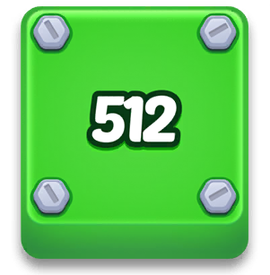
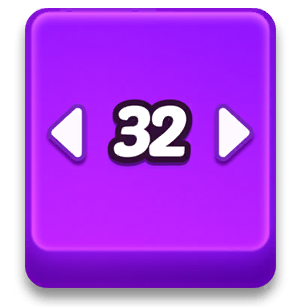
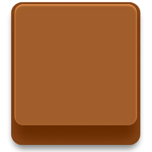

# 🎮 BẢNG ĐẶC TẢ GAME MECHANICS & DANH SÁCH ORDER UI ASSETS
> **Dự án:** 2048 Block Order (*Blocked-In*)  
> **Mục đích:** Tài liệu bàn giao cho UI/UX Designer & 2D Game Artist để vẽ và thiết kế toàn bộ tài nguyên hình ảnh (Assets, Icons, Badges, VFX, Overlays).

---

## 📌 TỔNG QUAN PHONG CÁCH ĐỒ HỌA (ART STYLE & GUIDELINE)
* **Phong cách (Style):** Casual 3D Glossy / Chibi Toy Aesthetic (khối gạch bóng bẩy dạng kẹo/nhựa dẻo bo góc mềm mại, nổi khối có độ dày 3D, viền bóng vát bevel, ánh sáng phản chiếu specular cao cấp).
* **Bảng màu:** Rực rỡ, tương phản cao, mỗi số mang một tông màu nhận diện đặc trưng (Cyan, Cam, Hồng cánh sen, Tím neon, Vàng kim, Xanh lá chuối, Xanh dương đậm,...).
* **Font chữ số:** Font dập nổi, tròn trịa, hoạt hình, có 3 lớp viền tương phản (Stroke 1 viền tối, Stroke 2 viền bóng, Stroke 3 highlight).

---

## 🧊 1. MECHANIC: ICE BLOCKS (KHỐI ĐÓNG BĂNG)

### 1.1. Mô tả Gameplay (Mechanic Logic)
* **Khái niệm:** Khối gạch bị bao bọc trong một tảng băng trong suốt lạnh giá.
* **Quy tắc di chuyển:** Người chơi **KHÔNG THỂ kéo/trượt** khối băng và **KHÔNG THỂ ghép trực tiếp** vào nó khi nó đang bị đóng băng.
* **Cơ chế mở khóa (Unlock Trigger):**
  * Trên khối băng có gắn một **Huy hiệu Ổ khóa Băng (Ice Lock Badge)** ghi rõ **Con số mục tiêu** (Target Number, ví dụ: `512`, `1024`, `2048`...).
  * Người chơi phải ghép (merge) các khối tự do khác trên bàn cờ. Ngay khi có một khối bất kỳ đạt được giá trị đúng bằng số ghi trên ổ khóa, khối băng sẽ được kích hoạt!
  * Ổ khóa sẽ giật hiệu ứng phóng to nảy bật (*Pop animation*), sau đó tảng băng nứt vỡ tan thành nhiều mảnh vụn (*Ice Shards*), giải phóng khối bên trong trở lại thành khối bình thường có thể kéo thả và ghép tiếp.

### 1.2. Các trạng thái hiển thị (Visual States)
1. **Trạng thái Đóng băng (Frozen / Locked):** 
   - Lớp băng mờ/tinh thể tuyết phủ quanh viền và 4 góc khối.
   - Ở giữa gắn Ổ khóa băng màu xanh thạch anh (`#122E7A`), số dập nổi rõ nét.
2. **Trạng thái Mở khóa (Unlocking Burst):**
   - Ổ khóa phồng to (Scale 1.0 $\to$ 1.63 $\to$ 1.0).
   - Vết nứt băng lan nhanh trên bề mặt.
3. **Trạng thái Vỡ (Shattered):**
   - Các mảnh vụn băng văng ra xung quanh, khối gạch lộ diện màu gốc rực rỡ kèm vệt hào quang sáng.

### 1.3. Checklist Assets cần vẽ cho Designer
| Tên Asset | Kích thước / Định dạng | Mô tả chi tiết |
| :--- | :--- | :--- |
| **Icon_Mechanic_Ice** | `361 x 303 px` (PNG trong suốt) | Icon minh họa khối băng kèm ổ khóa hiển thị trong popup mở tính năng mới (FTUE). |
| **IceLock_Badge** | `220 x 222 px` (PNG / Vector) | Ổ khóa băng màu xanh ngọc băng tuyết, có khoảng trống dập số ở giữa. |
| **Ice_Overlay_Border** | Bộ 9-slice / 4 góc `Ice_Corner_*` | Lớp viền băng tuyết phủ lên các khối gạch đa giác kích thước khác nhau. |
| **Ice_Shards_VFX** | Sprite sheet hoặc 4-6 mảnh rời | Mảnh vỡ băng sắc nhọn có độ trong suốt và lấp lánh khi khối nứt vỡ. |

---

## 🔩 2. MECHANIC: STATIONARY BLOCKS (KHỐI BẮT VÍT / CỐ ĐỊNH)

### 2.1. Mô tả Gameplay (Mechanic Logic)
* **Khái niệm:** Khối gạch vẫn mang giá trị số bình thường nhưng bị **bắt đinh vít / bu-lông lục giác kim loại** đóng chặt xuống sàn bàn cờ.
* **Quy tắc di chuyển:**
  * Người chơi **KHÔNG THỂ kéo di chuyển** khối này.
  * Khi người chơi cố tình chạm kéo, khối sẽ rung lắc tại chỗ (*Locked Wobble* / *Push Feedback*) để báo hiệu khối đang bị kẹt cứng.
* **Cơ chế ghép (Merge Rule):**
  * Người chơi **CÓ THỂ kéo khối tự do khác có cùng số đâm vào khối này để ghép!**
  * Khi merge thành công, các đinh vít sẽ bung ra/biến mất, khối mới sinh ra sẽ trở thành khối tự do hoàn toàn.

### 2.2. Các trạng thái hiển thị (Visual States)
1. **Trạng thái Cố định (Pinned Idle):**
   - Các bu-lông kim loại màu bạc lục giác được gắn ở các góc hoặc tâm các ô của khối.
   - Dưới chân bu-lông có bóng đổ ăn sâu xuống khối gạch.
2. **Trạng thái Bị kéo thử (Drag Attempt / Resist):**
   - Khối giật nhẹ theo hướng ngón tay rồi bật ngược lại, các bu-lông nảy nhẹ.
3. **Trạng thái Giải thoát (Merged & Released):**
   - Bu-lông xoay bung ra và tan biến, khối bừng sáng hợp nhất.

### 2.3. Checklist Assets cần vẽ cho Designer
| Tên Asset | Kích thước / Định dạng | Mô tả chi tiết |
| :--- | :--- | :--- |
| **Icon_Mechanic_Cage** | `361 x 303 px` (PNG trong suốt) | Khối gạch xanh lá mang số 512 có 4 ốc vít kim loại lớn ở 4 góc (Icon FTUE popup). |
| **Screw_Bolt_Greyscale** | `128 x 128 px` (3 biến thể góc quay) | Đầu bu-lông lục giác thép kim loại xám/bạc tả thực viền bevel (không ám màu). |
| **Screw_Shadow_Mask** | `128 x 128 px` (PNG) | Lớp bóng đổ mềm dưới chân ốc vít để áp dụng theo màu nền gạch. |

---

## ↔️ 3. MECHANIC: ARROW BLOCKS (KHỐI GIỚI HẠN HƯỚNG TRƯỢT)

### 3.1. Mô tả Gameplay (Mechanic Logic)
* **Khái niệm:** Khối gạch bị giới hạn chỉ được phép di chuyển theo **MỘT TRỤC DUY NHẤT**:
  * **Chỉ trượt Ngang (Horizontal Only):** Chỉ được kéo sang Trái hoặc sang Phải.
  * **Chỉ trượt Dọc (Vertical Only):** Chỉ được kéo Lên trên hoặc Xuống dưới.
* **Quy tắc di chuyển:**
  * Nếu người chơi kéo vuông góc với chiều cho phép, khối bị khóa lại và chỉ rung nhẹ.
* **Quy tắc hợp nhất hướng (Resolve Merged):**
  * Khối Ngang + Khối Tự do = Khối Tự do.
  * Khối Ngang + Khối Dọc = Khối Tự do (kết hợp cả 2 trục $\to$ Free).
  * Khối Ngang + Khối Ngang = Khối Ngang.

### 3.2. Các trạng thái hiển thị (Visual States)
1. **Dấu hiệu nhận biết:**
   - Trên mặt khối xuất hiện **Cặp mũi tên phát sáng** chỉ 2 đầu hướng đi cho phép (Trái-Phải hoặc Lên-Xuống).
   - Mũi tên gồm 3 layer: Lớp bóng đổ đáy (`Shadow`), Lớp viền tương phản (`Stroke`), Lớp đỉnh màu trắng phát sáng (`Top`).
   - Với khối dài/rộng: Dùng cụm dải mũi tên đôi dập nổi (`Movement_Double_Horizontal/Vertical`).

### 3.3. Checklist Assets cần vẽ cho Designer
| Tên Asset | Kích thước / Định dạng | Mô tả chi tiết |
| :--- | :--- | :--- |
| **Icon_Mechanic_SingleAxis** | `361 x 303 px` (PNG) | Khối gạch tím số 32 có 2 mũi tên trắng hướng Trái/Phải (Icon FTUE popup). |
| **Movement_Single_Arrow_Set** | Vector / PNG Layered (`120 x 195 px`) | Bộ đầu mũi tên đơn gồm: Top trắng, Stroke viền sẫm, Shadow bóng đổ. |
| **Movement_Double_Horizontal** | `168 x 129 px` (PNG) | Cụm mũi tên đôi ngang nổi 3D dùng cho các khối dài. |
| **Movement_Double_Vertical** | `129 x 168 px` (PNG) | Cụm mũi tên đôi dọc nổi 3D dùng cho các khối cao. |

---

## 🧱 4. MECHANIC: DUD BLOCKS / BLOCKERS (KHỐI CHẶN / GẠCH RÁC)

### 4.1. Mô tả Gameplay (Mechanic Logic)
* **Khái niệm:** Khối gạch đặc màu xám kim loại hoặc nâu đất nhám, **KHÔNG CÓ CON SỐ NÀO TRÊN MẶT** (`number = null`).
* **Quy tắc chơi:**
  * **KHÔNG THỂ MERGE:** Không thể ghép với bất kỳ khối số nào, cũng không thể ghép hai khối Dud với nhau.
  * **CÓ THỂ KÉO TRƯỢT TỰ DO:** Người chơi có thể trượt khối Dud đi chỗ khác để dọn chỗ cho các khối số di chuyển đến với nhau.
  * Đóng vai trò là vật cản địa hình di động, đòi hỏi người chơi phải xếp dồn vào góc hoặc luân chuyển khéo léo.

### 4.2. Checklist Assets cần vẽ cho Designer
| Tên Asset | Kích thước / Định dạng | Mô tả chi tiết |
| :--- | :--- | :--- |
| **Icon_Mechanic_Blocker** | `361 x 303 px` (PNG) | Khối gạch trơn không số màu xám chì / nâu đất (Icon FTUE popup). |
| **Dud_Block_Texture** | Color Ramp / 9-slice | Texture khối màu xám kim loại mờ hoặc vân xước công nghiệp để tách biệt hẳn với khối số sặc sỡ. |

---

## ⚡ 5. MECHANIC: POWER-UPS / BOOSTERS (TÍNH NĂNG BỔ TRỢ)

### 5.1. Power-Up: LEVEL UP (TỰ ĐỘNG GHÉP CẶP TỨC THÌ)

* **Cách hoạt động:** Khi người chơi gặp thế cờ khó/kẹt đường, bấm kích hoạt Level Up $\to$ Hệ thống sẽ quét toàn bộ bàn cờ tìm 1 cặp khối có cùng số, tạo lực hút từ trường kéo 2 khối đó xuyên qua mọi vật cản và merge ngay lập tức!
* **Assets cần vẽ:**
  * **Icon Nút Level Up:** Nút tròn/vuông nổi 3D, icon khối gạch xanh bọc viền vàng kim có mũi tên cam thăng cấp.
  * **Trạng thái nút:** Normal, Free (có ruy băng FREE), Locked (ổ khóa xám), Disabled (hết lượt dùng).
  * **VFX Hút:** Vệt sáng hào quang và tia hạt kéo 2 khối về phía nhau.

---

### 5.2. Power-Up: TIME FREEZE (ĐÓNG BĂNG ĐỒNG HỒ 20 GIÂY)

* **Cách hoạt động:** Đóng băng thanh đếm ngược thời gian trong 20 giây. Toàn bộ thanh thời gian đóng một lớp băng trắng xanh, mép màn hình phủ sương tuyết lạnh.
* **Assets cần vẽ:**
  * **Icon Nút Time Freeze:** Chiếc đồng hồ viền xanh gỗ đóng băng tuyết tan chảy.
  * **Thanh TimeFreeze_TimerBar:** Thanh hiển thị thời gian băng đóng (`20s`).
  * **Vignette Sương Giá (Frost Border):** Lớp overlay tuyết trắng viền mép màn hình điện thoại trong suốt thời gian kích hoạt.

---

## 🏆 6. MECHANIC: WIN TARGET & MAGIC JAR (MỤC TIÊU MÀN & BÌNH THỦY TINH)

* **Mục tiêu màn chơi (Win Condition):** Ghép các khối để đạt được con số cực đại của màn (ví dụ số `2048`).
* **Hiệu ứng thắng cuộc (Win Sequence):**
  * Khi khối số cực đại cuối cùng được ghép thành công, khối này sẽ hóa lỏng thành một **Dòng suối nước/cát phát sáng rực rỡ** (*Water Stream*).
  * Dòng nước uốn lượn hình vòng cung trên không trung và rót đầy vào **Bình Thủy Tinh Ma Thuật (Magic Sand Jar)** đặt ở đầu bàn cờ.
  * Khi bình đầy nước, sóng nước dập dềnh, nắp bình bật sáng tỏa ra làn sóng ánh sáng ăn mừng chiến thắng!
* **Assets cần vẽ:**
  * **Bình Thủy Tinh (Magic Jar):** Bình rỗng trong suốt, hiệu ứng nước dâng, bọt khí, dây thừng cổ bình và thẻ bài ghi số mục tiêu.
  * **Dòng suối nước / VFX:** Tia nước lấp lánh (Crystal water droplets, splash, glints).

---

## 📐 7. BẢNG TỔNG HỢP DANH MỤC ORDER UI (DESIGN ORDER SHEET)

| STT | Nhóm | Tên Asset | Số lượng | Kích thước chuẩn | Ghi chú kỹ thuật |
| :---: | :--- | :--- | :---: | :---: | :--- |
| **1** | **Mechanic Icons** | `Icon_Mechanic_Ice.png` | 1 | 361 x 303 px | Khối băng xanh + ổ khóa 1024 (FTUE popup) |
| **2** | **Mechanic Icons** | `Icon_Mechanic_Cage.png` | 1 | 361 x 303 px | Khối xanh lá + 4 ốc vít kim loại 512 |
| **3** | **Mechanic Icons** | `Icon_Mechanic_SingleAxis.png`| 1 | 361 x 303 px | Khối tím + mũi tên 2 chiều 32 |
| **4** | **Mechanic Icons** | `Icon_Mechanic_Blocker.png` | 1 | 361 x 303 px | Khối trơn nâu đất/xám chì không số |
| **5** | **Game In-Board** | `IceLock_Badge.png` | 1 | 220 x 222 px | Ổ khóa băng tuyết dùng render trên khối |
| **6** | **Game In-Board** | `Ice_Overlay_Set` | 4 góc + 4 mép | 128 x 128 px / góc | Lớp băng tuyết ghép phủ quanh khối |
| **7** | **Game In-Board** | `Screw_Greyscale_01..03.png`| 3 biến thể | 128 x 128 px | Đầu bu-lông lục giác kim loại 3D xám bóng |
| **8** | **Game In-Board** | `Movement_Arrows_Set` | 4 hướng | 160 x 240 px | Layer Top, Stroke, Shadow mũi tên |
| **9** | **Power-Ups** | `PowerUp_LevelUp.png` | 1 | 256 x 256 px | Icon HUD Booster thăng cấp ghép đôi |
| **10**| **Power-Ups** | `PowerUp_TimeFreeze.png` | 1 | 256 x 256 px | Icon HUD Booster đồng hồ đóng băng |
| **11**| **Popups FTUE** | `Panel_Popup.png` | 1 | 780 x 920 px (9-slice)| Khung viền popup mở tính năng |
| **12**| **Win Elements** | `Magic_Sand_Jar.png` | 1 bộ layers | 300 x 400 px | Bình thủy tinh hứng nước ăn mừng chiến thắng |
